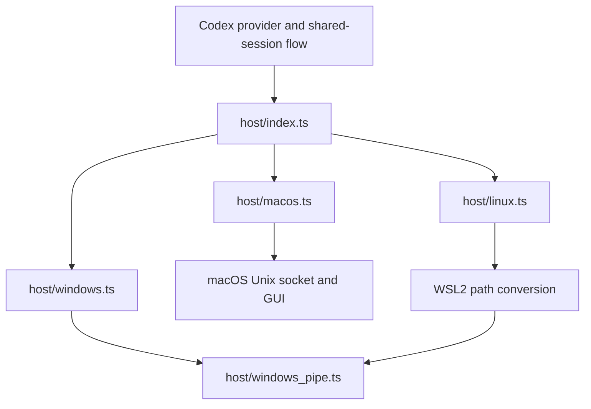

# wxBridage Host Platform Adapters

The host OS implementation is separate from chat platforms such as WeChat and model providers such as Codex and Claude Code. This refactor covers the active wxBridage desktop-sharing, CLI and WeChat service runtime. It preserves existing commands, configuration identifiers, target keys, IPC messages, errors and shared-session behavior. Independently packaged, paused workstreams retain their own implementation boundaries.

| Module | Responsibility |
| --- | --- |
| `src/providers/codex/host/index.ts` | Select the OS adapter; retain the existing explicit Windows pipe helper entry point. |
| `host/contracts.ts` | Provider-local target, transport, CLI and adapter contracts; no OS selection. |
| `host/common.ts` | Shared target validation, portable CLI defaults and Unix process termination. |
| `host/macos.ts` | macOS target paths, endpoint canonicalization, Unix socket ownership checks and GUI submission. |
| `host/windows.ts` | Windows paths, CLI shims/suffixes, process-tree termination and native pipe launch. |
| `host/windows_pipe.ts` | Verified PowerShell helper stream, cancellation, readiness and cleanup. |
| `host/linux.ts` | Linux/WSL2 detection, distribution validation, path conversion and Windows interoperability. |
| `host/linux_credential_store.ts` | Existing Linux secret-tool backend, extracted without changing credential behavior. |
| `credential_data.ts` | Shared credential types and parsing; encrypted-file storage stays platform independent. |
| `scripts/service/platform/{macos,windows,linux}.mjs` | OS-specific service environment paths and initialization, selected by `platform/index.mjs`. |

Common provider files call the adapter contract or inspect capabilities. Add OS-specific behavior to the relevant adapter, rather than adding `win32`/`darwin`/`linux` branches to routing, submission or provider configuration code. Reusable validation and stream primitives stay shared. Linux/WSL intentionally reuses the Windows pipe protocol after translating the helper paths.

The existing service installation and management scripts already have separate launchd, systemd and Windows Task Scheduler implementations, so their public names remain unchanged. Claude Code shared sessions continue to use their existing local MCP Channel adapter.

Linux independent conversations remain supported. Codex desktop sharing on Linux still requires WSL2; this structural change does not add native Linux Codex Desktop support. Windows/WSL2 desktop acceptance still requires real Windows testing.

No dependency, database, migration or persisted data-format change is introduced. The product version is advanced from 0.1.17 to 0.1.18 in the package entries and Codex client metadata. The existing `app_client.ts` remains a large protocol client (4,571 lines); this change extracts its OS behavior only, avoiding unrelated protocol restructuring. All newly introduced host implementation files are below 150 lines.

Verification uses the existing Codex/Claude sharing, CLI/configuration, account-store and output-checkpoint tests, plus regression checks for stable target keys, macOS defaults, service environment paths and packaged helper lookup. Tests run sequentially to limit resource use. Native Windows and WSL2 acceptance is separate from simulated platform tests.

## Verification Record — 2026-10-11

- Before extraction: 162 related tests passed, with one native Windows test skipped on macOS.
- After extraction: 474 tests passed, 24 skipped, zero failures. The run covers the host adapters, Codex and Claude sharing, Codex CLI/config/account handling, shared-output checkpoints, provider integration, WeChat runtime and bridge coordinator; `--test-concurrency=1` was used.
- TypeScript compilation passed with Node 24 using `node node_modules/typescript/bin/tsc -p tsconfig.json`.
- Compiled adapter imports and the packaged PowerShell helper path passed a runtime check. Host imports contain no cycles.
- Service scripts passed Node syntax checks; product metadata, README links and `git diff --check` passed.
- Native Windows/WSL2 desktop acceptance and Linux host execution remain unverified in this macOS environment. The operating-system changes were tested through platform simulation and local transport fixtures.
