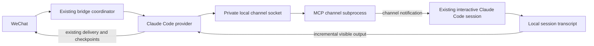

# Claude Code shared sessions

## Scope and authorization

The user chose the existing-PC-session option and requested its implementation in this conversation. This change adds a Claude Code provider to the existing WeChat sharing workflow, using the existing TypeScript/Node runtime and file repositories. It does not introduce a database or a new UI. This document records implementation decisions under that authorized scope; it does not claim separate document approval.

Requirements: `/enter claude` lists existing local Claude Code sessions without changing the current binding; `/enter <number>` selects one; only shared-mode messages reach that session; `/exit` restores the previous independent chat. Text and transcribed voice are supported. Visible assistant output and completion duration are synchronized. Existing Codex sharing remains compatible.

## Design



The provider owns session inventory, submission correlation and read-only observation. A channel subprocess started by Claude owns the socket and only sends notifications into its parent session. The launcher resumes the selected ID, retains project settings and permissions, and adds a channel; it never uses `--fork-session` or bypasses tool permissions. Transcript readers ignore sidechains, reasoning, tools and completed history. A `turn_duration` record is the completion signal; quiet output alone is never treated as completion.

```mermaid
flowchart TD
  L[/enter claude] --> I[Read local inventory, page of 10]
  I --> E[/enter number]
  E --> Q{Selected session channel available?}
  Q -->|No| H[Show command to enable; preserve binding]
  Q -->|Yes| R[Bind shared session; remember independent session]
  R --> N[Send message over channel with unique request ID]
  N --> A{Correlated transcript message appears?}
  A -->|Yes| O[Stream visible output, then completion and duration]
  A -->|Timeout or disconnect| U[Report uncertain submission; never auto-resend]
  R --> X[/exit: detach observation and restore independent session]
```

The socket is restricted to the current OS user (private directory and socket). Input/frame sizes and timeouts are bounded, executable arguments use arrays, session IDs are validated UUIDs, transcript discovery excludes symlinks and nested subagent transcripts. Inventory is limited to 5,000 sessions; transcript attachment reads at most 8 MiB, then 512 KiB per poll. No credentials or plaintext conversations are persisted in a second bridge store. Existing checkpoint hashes are reused for outbound deduplication. The new profile is sharing-only: `/exit` uses the remembered independent profile, or the configured default if no previous chat existed.

## Compatibility and limits

Claude Channels is a research preview. The first session connection needs interactive channel opt-in with `--dangerously-load-development-channels server:codexbridge-weixin`; this bypasses the channel plugin allowlist only, not tool permission checks. Organization policy can block channels. An already-running session that was started without channel support must first be opened with the launcher using its existing ID; an unconfigured terminal cannot be attached transparently. This adapter targets local Claude Code CLI sessions, not ordinary Claude Desktop chats. Keeping the process running, the computer awake and networking available allows locked-screen use; terminal approval prompts can still require local attention.

A channel write acknowledgment does not prove Claude processed the message. Submission is confirmed by matching the request ID in the transcript. Missing correlation is reported as uncertain, with no fallback writer. Concurrent CLI `--resume` processes are never started by shared turns. Stop targets the channel's verified Claude parent and only the still-active correlated turn.

Official contracts: [Channels](https://code.claude.com/docs/en/channels-reference), [programmatic CLI](https://code.claude.com/docs/en/headless).

## Verification

Implemented modules: `src/providers/claude/session_catalog.ts`, `transcript.ts`, `channel_client.ts`, `channel_server.ts`, `plugin.ts`, `launcher.ts`; existing coordinator/provider contracts and CLI registration carry the shared binding. The existing coordinator (over 21,000 lines), CLI (over 1,000) and translation map (over 2,500) retain their established responsibilities. Only the scoped command/registration hooks are changed; splitting those baseline modules would expand this change into unrelated refactoring.

Verification: 14 Claude tests in `test/providers/claude/shared_sessions.test.ts` cover bounded transcript fixtures, real MCP stdio/local-socket notifications with synthetic data, channel rejection/cancellation/bounds, uncertain delivery, tracked stop and cross-provider enter/exit restoration. Five selected existing coordinator sharing tests, 28 existing Codex IPC/relay tests and 15 CLI tests cover regressions (62 total, all passed). Scoped TypeScript checks and `git diff --check` passed. Product version is `0.1.12 → 0.1.13` in `package.json`, the package lock, Codex client metadata and the new channel server. Read-only inspection of this Mac finds five valid local Claude sessions with project directories; installed Claude Code 2.1.206 recognizes the development-channel flag. No live model prompt, real WeChat roundtrip, native parent interruption or locked-screen acceptance test has been performed. The native CLI's channel gate can require interactive confirmation and can still be blocked by account/organization policy.
