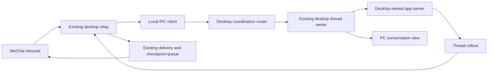
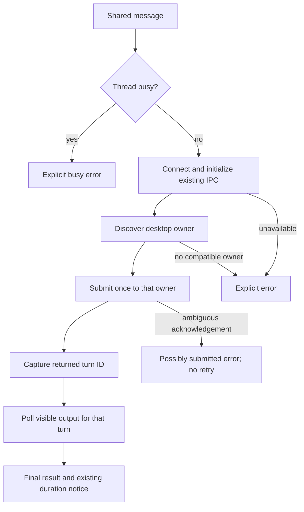

# Desktop background sharing

## Scope and requirements

The user selected option 1 in this conversation: WeChat sends to the backend already owned by the desktop, preserving the same PC thread while the screen is locked. This extends the previously approved shared-thread design using the existing TypeScript stack, bindings, rollout observer and delivery checkpoints. No database, additional model credentials, desktop application patch, or new dependency is required.

- `/enter`, `/exit` and `/status` retain their current meaning. Standalone execution remains separate.
- Shared submission must reach the desktop owner through a local background connection. It must not simulate keystrokes, create another app-server writer, change permissions/model/workspace, or unlock the computer.
- Reject a busy thread; serialize WeChat submissions and correlate successful replies by the desktop's returned turn ID.
- Missing desktop owner, incompatible protocol, disconnect, invalid response and timeout fail explicitly. Never automatically retry a dispatched turn or fall back to another writer. An ambiguous acknowledgement is reported as possibly submitted.
- Keep existing visible-output forwarding, completion timing, restart checkpoints and voice-transcript behavior.
- Screen lock is supported by the transport; sleep, logout, quitting the desktop, and operations requiring an unlocked GUI remain limitations.

Authorization source: the user's “好的，帮我按照第 1 种方式修改”, following the proposed shared-backend architecture. The IPC adapter is the implementation detail used to reach that existing backend. Desktop-owned execution and existing provider/runtime boundaries remain intact.

## Architecture and contracts

`desktop_ipc_client.ts` connects only to the existing desktop coordination socket, normally `$CODEX_HOME/ipc/ipc.sock`. It checks socket/directory ownership and writable permissions, implements bounded length-prefixed JSON framing, initializes as `codexbridge`, discovers the local thread owner, and targets that owner with `thread-follower-start-turn`. Requests inherit desktop thread settings. It does not start a router, claim thread ownership or serve follower requests.

`desktop_thread_relay.ts` owns submission serialization and rollout correlation. IPC is the default transport; the old GUI transport remains an explicit compatibility option. Output is read through the existing rollout reader, retaining WeChat delivery checkpoints. A successful IPC response supplies the exact turn ID before output polling begins.

The coordination protocol is internal and versioned, not a public third-party API. Inspection of the installed desktop bundle established owner-discovery version 1 and start-turn version 2. The actual running desktop accepted initialization and owner discovery for the current shared thread. Public App Server transport documentation alone does not establish this IPC contract. A desktop update may require adapting the client; mismatches must fail closed.

Validation plan: local socket fixture tests for framing, exact owner targeting, inherited settings, fragmentation, malformed/oversized responses, disconnect/timeouts and cleanup; relay tests for no GUI calls, exact turn association, busy rejection and unchanged output behavior. Only targeted tests and type checks run on this machine. Actual lock-screen execution must be distinguished from socket/mock verification. No test sends a WeChat message or modifies a user's active task.

## Implementation and verification

Implemented in `src/providers/codex/desktop_ipc_client.ts` (239 lines) and the existing desktop relay (748 lines). The relay now defaults to IPC, captures the acknowledged turn ID and holds the observer cursor while ownership is uncertain; a possibly accepted turn can still be observed after an acknowledgement is lost. Explicit GUI compatibility remains available. Version advances from 0.1.11 to 0.1.12 in package.json, package-lock.json and Codex app-client metadata.

Verification: 28 IPC/relay tests passed, plus 11 selected provider/runtime tests covering text/voice routing, output checkpoints, notices, exit/switch behavior and observer errors. Scoped TypeScript validation and `git diff --check` passed. A real connection using the new client initialized and discovered the current desktop owner successfully. A targeted v2 request with a deliberately mismatched thread ID reached the desktop owner and returned the expected pre-submission validation error; no user prompt or model turn was submitted. This verifies the live routing/version boundary, not a complete task execution.

Actual locked-screen message submission and full WeChat round-trip have not been exercised automatically. No test locks the screen, sends a WeChat message, changes an existing task, or adjusts system settings. Mermaid diagrams are source only, not render-verified. The full suite is omitted because of this machine's earlier trouble with that workload.
