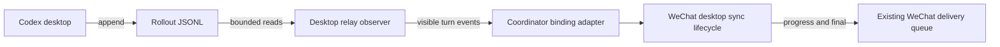
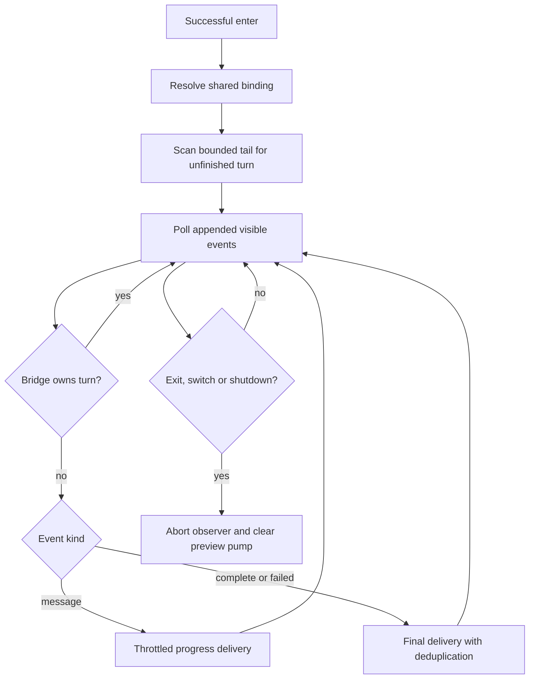

# Desktop output synchronization

Scope: the user approved attaching to a running desktop turn, forwarding new visible output in batches, and delivering its final result without duplicates in this conversation. Implementation uses the existing TypeScript runtime, desktop rollout reader, and WeChat delivery queue. No database or new dependency is involved.

## Requirements

- Entering a thread attaches to its current unfinished turn and replays only visible assistant messages from that turn. Completed history is not replayed.
- Continue forwarding desktop-started turns while shared. Bridge-submitted turns use their existing response delivery, without a second copy from the observer.
- Forward commentary and final-answer messages as they appear in the rollout. Reasoning, tools, and private metadata are excluded. The log records completed message segments; token-by-token output is not guaranteed.
- Leaving, switching binding, or stopping the runtime cancels the observer without stopping desktop execution. Polling uses bounded reads and cached paths.
- WeChat delivery retains its existing throttling/retry behavior. Observer errors are reported; no independent turn is created as recovery.
- After final delivery, send a separate completion notice and full turn duration for both observed and bridge-submitted shared replies. Use finite nonnegative `duration_ms` first; otherwise derive from recorded start/end timestamps (epoch seconds or the record's ISO timestamp). Preserve the start time across a mid-turn snapshot. Missing timing stays unknown; attachment time is never substituted. Failures are labeled as interrupted or failed. Leaving or switching binding suppresses subsequent notices.

## Architecture

The coordinator exposes an optional read-only observer contract. A small runtime helper owns one cancellable observer per WeChat scope; the existing large coordinator/runtime files receive only integration methods. Snapshot/read cursors retain incomplete UTF-8 records, and the reader discovers rotated files periodically instead of traversing the sessions tree on every tick.

Validation: synthetic rollout files for active/idle history, message association, duplicate exclusion, split records; provider progress forwarding; runtime enter/exit/switch cancellation and final deduplication. Live sending is left to normal user messages after deployment; tests do not send WeChat messages or submit desktop prompts.

## Implementation evidence

Implemented in `src/providers/codex/desktop_thread_relay.ts`, the optional provider/coordinator observer adapters, and `src/runtime/desktop_thread_sync.ts`. No stored binding schema was changed. The lifecycle helper is separate (about 130 lines); the existing large coordinator, provider plugin, runtime, and locale catalog are retained to keep this feature scoped and avoid an unrelated structural refactor.

Targeted checks passed for the desktop reader/relay, binding selection and restoration, persisted scope reload, and WeChat preview/final delivery. The final type check is scoped to these components. A full repository suite is intentionally omitted because this machine previously had trouble during that workload. Diagrams are Mermaid source and have not been visually rendered. Product version advances from 0.1.8 to 0.1.9 in package.json, package-lock.json and Codex client information.

The completion-notice extension advances 0.1.9 to 0.1.10 in the same version entries. `durationMs` is an optional additive provider/result field carried into response metadata; no stored schema or desktop submission protocol changes. Formatting lives in `src/runtime/desktop_turn_notice.ts`, and notifications reuse existing text delivery after final-answer deduplication. Acceptance covers recorded duration precedence, mid-turn attachment, timestamp fallback, zero/absent/invalid timing, interrupted turns, own-turn metadata forwarding, standalone isolation, and cancellation on exit. Verification results are recorded after the final targeted checks.

Completion-notice checks: 13 desktop relay/reader tests, 15 runtime desktop/preview/final-answer tests, 2 selected provider tests and 6 coordinator sharing tests passed. Scoped TypeScript validation passed using the repository's `strict: false` configuration, and `git diff --check` passed. An additional runtime check verifies suppression when a bridge-submitted turn finishes after exit or a thread switch. No full-suite or external-message test is performed.

## Restart and sentence-boundary repair (0.1.11)

The reported `我会把 rc.` fragment reproduces on 0.1.10: the runtime treats every ASCII period as a sentence boundary. An isolated two-instance run also reproduces duplicate progress after restarting an unfinished turn. The repair keeps periods inside ASCII version/IP tokens out of sentence boundaries, including an incomplete trailing `rc.` prefix. Complete desktop rollout segments bypass sentence preview slicing and use existing WeChat formatting, delivery-size splitting, and its throttled send queue.

`desktop_segment_delivery.ts` sends a segment one platform-sized chunk at a time; `desktop_sync_checkpoint.ts` records each successful acknowledgement by hashed chat/binding/turn and hashed phase/segment/chunk identity. Both observed and WeChat-submitted shared turns use this record. Replayed final segments still reconstruct the final-text comparison, preventing a second final send. Final delivery and completion-notice acknowledgements are also saved. Failed chunks do not advance the checkpoint; exit during an in-flight successful request still saves its acknowledgement.

The CLI supplies `runtime/desktop-sync-checkpoints.json` in the selected state directory; library callers can opt in with `desktopSyncCheckpointPath` (without it, acknowledgement tracking is in memory). Storage is bounded to 256 turns, 4096 chunks per turn and 8 MiB. Writes use a private temporary file, file fsync, and atomic rename; permissions are 0600. Malformed state fails explicitly instead of silently replaying. No database, dependencies, stored binding schema, or WeChat wire protocol changes are involved. Normal restarts resume acknowledged progress; the gap between remote acceptance and local commit cannot guarantee exactly-once delivery across an abrupt crash.

The runtime and CLI remain scoped integration points (about 2450 and 1120 lines); persistence and segment delivery live in separate small helpers to avoid unrelated restructuring. Product version advances from 0.1.10 to 0.1.11 in package.json, package-lock.json and Codex client information. Regression coverage includes first-entry replay, fresh-instance restart, repeated terminal events, own-turn handoff to observation, failed chunk recovery, chat isolation, cancellation, private-file permissions, malformed state and split version/IP input. Only targeted tests and type checks are run on this machine.

The segment sender uses the configured WeChat message limit and marks already formatted chunks for the platform adapter, avoiding a second formatting pass. This is an optional internal argument; normal callers and the iLink payload schema remain unchanged. Final checks passed: 22 selected runtime/checkpoint tests, 3 platform payload/chunk/send tests, scoped TypeScript validation (including the existing vendor declaration), and `git diff --check`. The old version reproduced the split fragment and repeated progress count of two in isolated mocks. Tests do not send live WeChat messages; the full repository suite is omitted due to the machine's earlier trouble with that workload.
