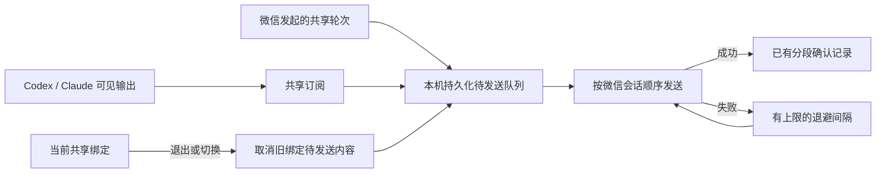

# 共享输出发送恢复

## 范围与依据

用户已确认修复诊断出的故障：Codex / Claude 的共享输出在微信发送失败后退出订阅，只有新入站消息才恢复；断线期间完成的轮次可能漏掉结果和耗时通知。本次沿用既有 Provider、共享绑定、微信通道和确认记录，不改变模型任务或客户端协议，不使用数据库。

## 设计

新增 `DesktopOutputQueue`，持久化轮次标识、共享绑定、工作目录、可见分段、最终状态和耗时。分段入队后不因微信发送失败向 Provider 抛出异常；每个微信会话串行消费，已确认分段复用现有 Hash 检查跳过。重试采用 5 秒起、最高 60 秒间隔，新的入站消息可提前唤醒队列。临时订阅读取异常单独退避恢复。

每轮保留可见分段，直到最终结果及完成/耗时通知确认成功，再删除队列记录。重启从队列恢复，不依赖 Provider 再次提供已结束历史。文本使用稳定的发送标识重试，发送时读取最新上下文令牌。微信服务端接收后、本地确认前崩溃仍不能承诺绝对不重复；不宣称外部接口提供未验证的 exactly-once 保证。

队列文件位于本机 runtime 目录，权限 0600，目录 0700，原子写入；内容含待发送正文，交付完成后清理。总大小、轮次数和单轮正文设上限，满额或落盘失败明确报错，不静默丢弃。退出/切换会话撤销旧绑定队列；关闭服务停止发送但保留待发送内容。每次发送前核对绑定，取消信号阻止后续分段；已在途请求成功仍记确认。

`DesktopThreadSync` 负责只读订阅及读取失败恢复；`DesktopOutputQueue` 负责有界存储、串行发送与重试；运行时负责组装正文、附件和结束通知。队列逻辑独立实现。既有超长文件本次评估：运行时约 2542 行，保留其正文、附件和通知组装以复用现有发送方法；微信插件约 1044 行，仅增加发送标识及令牌刷新；CLI 约 1140 行，仅增加 outbox 路径配置，不扩大为整仓重构。附件继续使用现有快照及确认机制，避免重复生成。首次进入仍只跟进当前及后续轮次，不回放未订阅的历史。

恢复范围是桥接器已经收集并入队的输出；桥接器关闭期间从未读取的消息仍遵循 Provider 初次订阅不回放已结束历史的规则。本次未修改 Provider 日志协议和读取游标持久化机制。

## 验证

使用合成输出和模拟微信发送验证：失败后不发新消息也自动恢复、任务在离线期间结束、最终通知发送失败重试、共享轮次两种发起路径、服务重启恢复、分段确认去重、上下文更新、退出/切换/关闭、队列限制与磁盘错误。运行相关共享/微信回归和 TypeScript 检查。本机上线后核对运行版本和服务状态；手机前后台切换、真实微信服务端拒绝和 Windows/WSL 实机行为另需真实环境验收。
