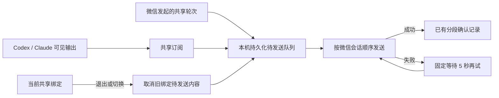

# 共享输出发送恢复

0.1.25 的进度合并、额度预留及长结果与结束通知优先级见 [微信回复额度设计](weixin-reply-budget.md)。实际发送失败仍按本文重试；本地计数不会阻止结束通知及其后剩余结果继续探测服务端恢复。

## 范围与依据

用户已确认修复诊断出的故障：Codex / Claude 的共享输出在微信发送失败后退出订阅，只有新入站消息才恢复；断线期间完成的轮次可能漏掉结果和耗时通知。本次沿用既有 Provider、共享绑定、微信通道和确认记录，不改变模型任务或客户端协议，不使用数据库。

## 设计

新增 `DesktopOutputQueue`，持久化轮次标识、共享绑定、工作目录、可见分段、最终状态和耗时。分段入队后不因微信发送失败向 Provider 抛出异常；每个微信会话串行消费，已确认分段复用现有 Hash 检查跳过。0.1.24 起，发送失败后固定等待 5 秒持续重试，不依赖任何新入站事件；新的入站消息或上下文更新仅可提前唤醒队列。临时订阅读取异常单独退避恢复，存储错误保留较长退避避免磁盘故障导致忙循环。

每轮保留可见分段，直到最终结果及完成/耗时通知确认成功，再删除队列记录。重启从队列恢复，不依赖 Provider 再次提供已结束历史。文本使用稳定的发送标识重试，发送时读取最新上下文令牌。微信服务端接收后、本地确认前崩溃仍不能承诺绝对不重复；不宣称外部接口提供未验证的 exactly-once 保证。

队列文件位于本机 runtime 目录，权限 0600，目录 0700，原子写入；内容含待发送正文，交付完成后清理。总大小、轮次数和单轮正文设上限，满额或落盘失败明确报错，不静默丢弃。退出/切换会话撤销旧绑定队列；关闭服务停止发送但保留待发送内容。每次发送前核对绑定，取消信号阻止后续分段；已在途请求成功仍记确认。

`DesktopThreadSync` 负责只读订阅及读取失败恢复；`DesktopOutputQueue` 负责有界存储、串行发送与重试；运行时负责组装正文、附件和结束通知。队列逻辑独立实现。既有超长文件本次评估：运行时约 2542 行，保留其正文、附件和通知组装以复用现有发送方法；微信插件约 1044 行，仅增加发送标识及令牌刷新；CLI 约 1140 行，仅增加 outbox 路径配置，不扩大为整仓重构。附件继续使用现有快照及确认机制，避免重复生成。首次进入仍只跟进当前及后续轮次，不回放未订阅的历史。

恢复范围是桥接器已经收集并入队的输出；桥接器关闭期间从未读取的消息仍遵循 Provider 初次订阅不回放已结束历史的规则。本次未修改 Provider 日志协议和读取游标持久化机制。

## 验证

### 0.1.24 持续探测发送

用户明确要求切回前台可能没有通知，因此队列须持续尝试。现场日志证实旧版确实自动发送，但通道内的 5/10/15 秒重试叠加队列最高 60 秒退避会拉长恢复窗口。本次仅调整共享文本：稳定 `deliveryId` 标识的发送每次调用只尝试一次，外层持久队列在失败返回后固定等 5 秒，不按失败次数加长或停止。保留独立消息原有有限重试、账号失效保护、发送队列节流、稳定 ID 和分段确认。网络请求时长、其他消息排队、磁盘故障仍可能延长间隔，不宣称服务端会因重试而解除拒收。

回归模拟连续 21 次拒收，期间不刷新上下文、不发送用户消息、不产生前台通知；每隔 5 秒继续发送，服务恢复后下一次发送成功且不再重复。验证共享路径不嵌套 4 次通道重试，独立消息仍保留原行为。产品版本从 0.1.23 递增为 0.1.24；无数据库或外部协议变化。插件约 1080 行只加一项重试参数，不扩展既有超长文件职责。

### 0.1.23 前台恢复复查

现场 0.1.22 的队列确实持续重试，但仍收到 `-2`；11:17 用户入站后上下文更新且积压送达。这证明不能把“重试仍未送达”宣称为已经修复，也不能仅凭返回码归因于前后台或固定令牌时效。腾讯公开协议未定义手机前台通知或主动令牌续期接口；上游 issue #286、#309 是相似用户报告，不能视为服务端契约。

本次修复的可复现缺口：`normalizeInboundEvent` 在保存上下文前过滤无正文载荷。调整为先通过发送者/会话允许策略校验，再缓存上下文，最后筛选业务正文。空或不支持的内容不进入模型。`pollOnce.contextUpdatedScopes` 是内部可选字段，Poller 独立通知运行时唤醒队列；普通消息、旧插件实现和同步游标语义保持兼容。重复批次消息仍可携带新的上下文，不能因正文去重漏掉刷新。无数据库变更。

诊断模块独立实现，只写时间、返回码、固定原因类别、会话/令牌/发送 ID 的 SHA-256 截断摘要，避免开启包含聊天正文的全量调试。评估保留既有超长插件文件（约 1077 行，仅调整其已有入站/发送路径）及运行时（2543 行，仅接一条回调），不扩展为无关重构。

旧版安装代码的隔离复现结果为 `contextRefreshed: false`；新用例验证空载荷刷新及立即补发、不创建模型轮次、无权发送者和 Bot 回显不可更新上下文、日志不泄漏原文。手机切前台是否产生该载荷仍须真实验证，不能由该模拟测试推定。

使用合成输出和模拟微信发送验证：失败后不发新消息也自动恢复、任务在离线期间结束、最终通知发送失败重试、共享轮次两种发起路径、服务重启恢复、分段确认去重、上下文更新、退出/切换/关闭、队列限制与磁盘错误。运行相关共享/微信回归和 TypeScript 检查。本机上线后核对运行版本和服务状态；手机前后台切换、真实微信服务端拒绝和 Windows/WSL 实机行为另需真实环境验收。
