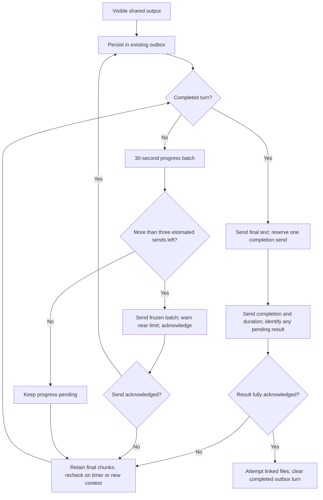

# Shared output within the WeChat reply budget

## Scope and evidence

The user approved the proposal to batch progress, reserve capacity for final results and elapsed-time notices, and warn before the reply allowance is exhausted (2026-10-12: “好的，按照你的建议来”). This changes delivery scheduling for the existing Codex and Claude Code shared-session flow. Existing TypeScript modules, private JSON state and transport are reused; no database, dependency, provider protocol, OS adapter or new external service is introduced.

Local 0.1.24 diagnostics showed two successive contexts accepting exactly ten sends. The next send returned `-2`; one context rejected 190 retries and the next reached the limit after 33 seconds. New inbound context restored delivery. [Tencent repository issue #81](https://github.com/Tencent/openclaw-weixin/issues/81) reports the same observation. Ten is a conservative local policy based on observed behavior, not an official server contract or a universal interpretation of `-2`.

## Scheduling and ownership

- `DesktopOutputQueue` persists every collected segment immediately and opens a 30-second progress batch window. Further commentary does not postpone that window. Final segments and completion bypass the delay. The existing per-chat worker, cancellation, bounded storage and five-second failure retries remain.
- `deliverDesktopProgress` packs pending progress under the existing 2048-byte wire limit, leaving 512 bytes for the bilingual quota reminder. It freezes each batch before sending; a failed request retains the exact body and delivery ID even if more progress arrives. Successful acknowledgement atomically records the original chunk keys. Existing individual-chunk acknowledgements remain usable.
- `WeixinReplyBudget`, owned by the WeChat adapter, counts distinct successful text sends, including command/independent replies, media and successful separate captions. Account-local records use hashed scope/context/client identities, private atomic writes, and a maximum of 256 contexts. Repeated envelopes with the same context do not reset it; late old-context acknowledgements cannot spend a new context's allowance. Updates run inside the adapter's existing serial send gate.
- Shared progress cannot consume the last three estimated sends. The sixth successful send, when it is progress, includes a one-time localized reminder to send `/status`. The reminder shares its progress bubble. `/status` refreshes context through a normal user message without submitting an AI prompt. Ordinary command/independent delivery is counted but retains its existing transport behavior.
- Once a turn completes, final text supersedes unsent intermediate progress. The complete progress history remains in the desktop session; old progress is not replayed ahead of a conclusion. Final text reserves one send for the completion/duration notice. If a long result cannot fit, send that notice with an explicit pending-content indication, retain all unsent final chunks, and continue after renewed context. Already acknowledged final chunks and the notice are not repeated.
- Linked files are attempted after the completion notice so an upload/caption cannot consume its reservation. Existing linked-file validation, limits and best-effort error reporting remain. General media sends count toward the same estimate; this change does not introduce a new durable media queue.

## State, compatibility and failure boundaries

`<accountsDir>/<accountId>.reply-budget.json` stores only hashes, counts-as-ID-sets and timestamps (0600). Restart retains the estimate. A new install cannot reconstruct previously consumed remote capacity, so the policy becomes accurate from the next new inbound context. The server may still reject earlier for other reasons or expiry; reservation cannot guarantee delivery in those cases.

The version-1 desktop checkpoint remains backward readable and gains an optional `progressBatch` containing at most one pending batch's visible text and chunk hashes per turn. It is private (0600), bounded and cleared after acknowledgement or final delivery. The outbox schema stays version 1 and its segment/completion content is unchanged. Old readers ignore the additional checkpoint field, although downgrading during an unacknowledged batched send can repeat that in-flight content. Take a source backup before deployment; preserve login, bindings, queues and checkpoints.

Local reservation is a deliberate deferral, not a failed remote request. The queue continues checking eligibility on its timer and wakes on new context. Completion notices and final remainders after a notice can probe even when the local estimate is zero, preserving automatic recovery if the server starts accepting again without a new context. Real network or `-2` failures retain the existing five-second retry behavior. No foreground event or automatic quota-renewal API is invented. Remote acceptance followed by a crash before local persistence remains an exactly-once limitation.

The large runtime (2573 lines), platform plugin (1106 lines) and bilingual catalog (2544 lines) are retained as integration points to avoid unrelated restructuring. New quota policy is isolated in `reply_budget.ts` (75 lines); batching/checkpoint handling is in the existing small delivery helpers. These paths are platform-neutral and do not combine Windows, Linux or macOS implementations.

## Acceptance

Regression coverage uses the actual runtime, platform adapter, outbox and checkpoint against a synthetic server that refuses the eleventh send. It covers both provider bindings, burst batching, one-time warning, three-slot reservation, oversized final text, elapsed-time delivery, fresh-context recovery, restart, unchanged-context replay, old-context in-flight acknowledgement isolation, UTF-8 limits and frozen-batch retry identity. Existing cancellation, offline recovery, media and standalone-delivery tests remain applicable.

Validation on 2026-10-12: 134 targeted tests passed with Node 24 and `--test-concurrency=1`, covering `desktop_reply_budget`, `desktop_output_recovery`, `desktop_output_queue`, `desktop_sync_checkpoint`, `weixin_bridge_runtime`, `weixin_linked_files`, and WeChat `plugin`, `context_recovery`, `poller` tests. The repository TypeScript check and `git diff --check` passed. The initial real-time 10 ms batching test was unreliable under local fsync latency; it now uses a simulated clock to verify the production 30-second boundary deterministically. This was a test timing correction, not a product delay change. Review was a local self-review; the Mermaid source was not visually rendered.

Product version changes from 0.1.24 to 0.1.25 in `package.json`, both root `package-lock.json` entries and `src/providers/codex/app_client.ts`. Real WeChat messages are not sent by tests. Production phone/background behavior remains subject to the external API; a passing synthetic test does not prove that quota or context expiry has been removed. The full repository suite is intentionally not run on this machine; checks are scoped to the changed delivery path and its consumers.
