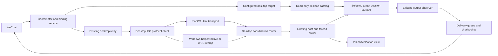
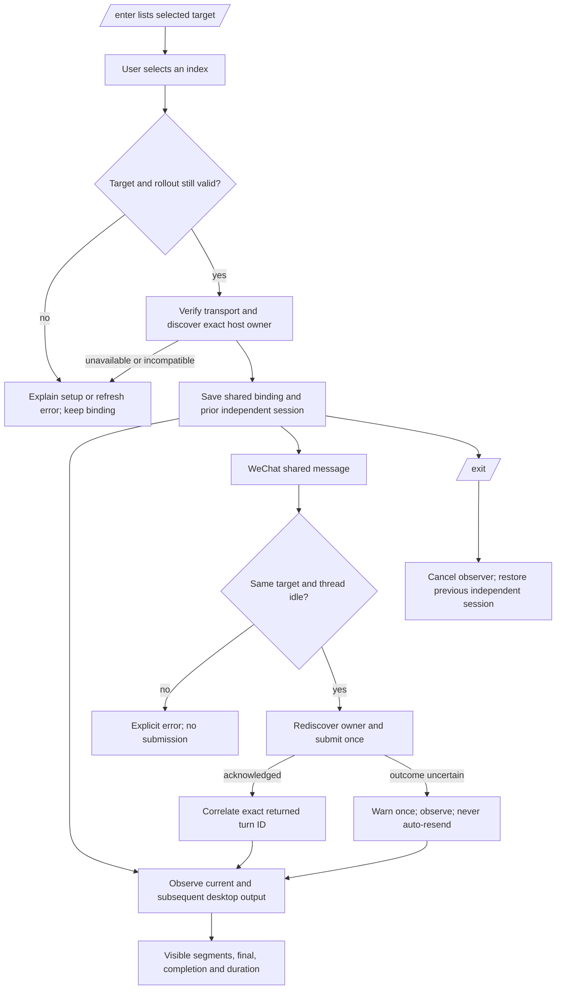

# Windows / WSL2 Codex shared-session architecture

Document version: 1.0 — 2026-10-11

Status: architecture proposal awaiting confirmation. [Requirements version 1.0](windows-wsl-sharing-requirements.md) were confirmed by the user's “确认，请继续”. No executable implementation or Windows/WSL end-to-end verification is recorded here.

## Decision and system boundary

Extend the existing desktop relay with a Windows named-pipe transport. A packaged PowerShell/.NET helper provides access to that pipe from either native Windows or WSL2 and verifies the Windows user boundary. Retain the existing Unix-socket implementation on macOS. All shared execution remains with the desktop application's existing thread owner.

One running bridge has one configured Codex desktop target: an endpoint, desktop host ID, and readable Codex home. `/enter` lists conversations from that target, ten per page. The user selects a conversation using the existing commands; no additional WeChat command language is needed. Windows-local and WSL-backed targets require different explicit storage/host configuration. Changing that configuration requires selecting the conversation again.

The bridge owns its bindings, delivery checkpoints, and helper processes. The desktop owns conversation execution, settings, and session files. The helper transports bytes and checks endpoint ownership; it does not execute prompts, launch Codex, patch the desktop app, or maintain another conversation owner. The shared catalog and output reader only read desktop storage. Independent WeChat execution continues to use its existing provider configuration.

Included combinations are native Windows bridge to Windows-local desktop threads; WSL2 bridge to Windows-local desktop threads; and WSL2 bridge to desktop-owned threads backed by the explicitly selected WSL distribution. Plain Linux, WSL1, remote computers, and attachment to an ordinary CLI process are outside this new transport. Existing Claude sharing is preserved.

## Reused stack and deployment

Reuse the existing TypeScript/Node.js project, Node.js 24 or later as declared in `package.json`, JSON-file repositories, `tsx` tests, and npm scripts. Add no npm runtime dependency, database, model credential, network service, or Windows Node installation requirement for a WSL bridge. The helper uses Windows PowerShell 5.1 with .NET and a fixed C# implementation compiled by `Add-Type`; policy restrictions or a missing runtime produce an explicit setup error. Do not bypass execution policy or request elevation automatically.

The helper script must ship in both the source distribution and the installed application layout. Its path is resolved relative to the package, never from a WeChat input. Existing Windows/WSL service installation remains separate from feature development: document foreground/service prerequisites without changing startup settings or restarting the current Mac service. Screen lock can leave this background connection operational while Windows, WSL, the desktop owner, and the bridge remain running. Sleep, logout, quitting the desktop, and GUI-dependent approval steps remain limitations.

## Modules and allowed dependencies

Paths below identify proposed new files and existing integration points; they do not indicate implementation has already happened.

| Module | Ownership and contract |
| --- | --- |
| `src/providers/codex/desktop_target.ts` (new) | Resolve platform, host ID, readable home, endpoint, and stable target key. Reject contradictory configuration. Provide immutable target data to the catalog, relay, and IPC client. |
| `src/providers/codex/desktop_ipc_transport.ts` (new) | Open a verified local duplex byte stream with cancellation and cleanup. Implement Unix and Windows-helper adapters. No knowledge of conversation content or WeChat. |
| `scripts/codex-desktop-pipe.ps1` (new) | Connect only to a local named pipe, verify server Windows SID, report readiness, and tunnel bounded frames. No arbitrary command/evaluation interface. |
| `src/providers/codex/desktop_ipc_client.ts` | Retain framing, request correlation, initialization, owner discovery, inherited settings, and single submission. Add explicit host routing and injected transport. |
| `src/providers/codex/desktop_session_catalog.ts` (new) | List/read thread metadata from the selected home with bounded reads and target-bound pagination. Never start/resume an app-server thread. |
| `src/providers/codex/desktop_thread_relay.ts` | Keep serialization, busy checks, turn correlation, visible-output parsing, and cancellation. Supply the same target to submission and rollout reading. Restrict GUI compatibility to macOS. |
| `src/providers/codex/plugin.ts`, `src/types/provider.ts` | Add optional desktop-specific listing/reading/target hooks. Keep independent provider APIs and existing Claude implementations compatible. |
| `src/core/bridge_coordinator.ts`, `src/core/bridge_session_service.ts`, `src/core/session_router.ts` | Route `/enter` browsing through the desktop catalog and bind a verified target/summary. Restore the saved independent binding on `/exit`. |
| `src/types/core.ts`, `src/types/repository.ts`, JSON stores | Persist additive desktop identity fields and distinguish desktop-only session records from independent ones. No destructive migration. |
| `src/runtime/desktop_thread_sync.ts` | Include desktop target identity in subscription/checkpoint keys and cancel old-target observation on a binding change. Preserve delivery behavior. |

The coordinator depends on optional provider contracts, not PowerShell or Codex path rules. The Codex provider depends on the target/catalog/relay. The IPC client depends on the transport contract. The transport and helper do not depend on core session repositories or delivery queues. Avoid introducing a parallel execution manager.

## Configuration and target identity

Keep `CODEXBRIDGE_CODEX_DESKTOP_SHARED_THREAD` and `CODEXBRIDGE_CODEX_DESKTOP_TRANSPORT`. The latter remains `ipc` by default. Keep `CODEXBRIDGE_CODEX_DESKTOP_IPC_SOCKET`, interpreted as a Unix socket on macOS or a local named-pipe path on Windows/WSL. Add:

| Setting | Meaning and default |
| --- | --- |
| `CODEXBRIDGE_CODEX_DESKTOP_HOME` | Absolute Codex home as seen by the bridge runtime. macOS retains the existing `CODEX_HOME`/user-home default. Native Windows defaults to its current user's `.codex`. WSL requires this setting explicitly so a Windows home is never confused with a Linux home. |
| `CODEXBRIDGE_CODEX_DESKTOP_HOST_ID` | Desktop routing host, default `local`. Accept `local` or `remote-wsl:` followed by the desktop's URI-encoded distribution name. Preserve distribution-name case. Reject other remote host kinds in this iteration. |
| `CODEXBRIDGE_CODEX_DESKTOP_POWERSHELL_BIN` | Optional absolute Windows PowerShell executable path. Resolve the system Windows PowerShell executable otherwise; do not use a project-local executable or a chat-provided path. |

Example target pairs, with placeholder account/distribution names:

| Bridge and target | Desktop home in bridge runtime | Host ID |
| --- | --- | --- |
| Native Windows, Windows-local | `C:\Users\Alice\.codex` | `local` |
| WSL2, Windows-local | `/mnt/c/Users/Alice/.codex` | `local` |
| WSL2, desktop-owned Ubuntu agent | `/home/alice/.codex` in that distribution | `remote-wsl:Ubuntu` |

In the third case, the configured home must be the one actually used by the desktop-owned WSL agent. Merely having a CLI rollout in that directory does not establish desktop ownership. A different distribution requires an accessible explicitly mapped home and an exact host ID; no default-distribution guess or automatic cross-distribution mounting is performed.

Validate WSL2 and Windows interoperability before using the helper. Resolve the bundled script to a Windows-readable path using a bounded `wslpath -w` subprocess; handle spaces, Unicode, drive mounts, and WSL UNC paths as argument values. Missing mapping, unavailable interoperability, or an unestablished WSL2 runtime fails before submission. Do not rewrite `CODEX_HOME`, `WSLENV`, authentication files, or WSL settings.

Compute `targetKey` from a versioned tuple of provider kind, host ID, canonical home, and canonical endpoint. Use canonical filesystem identity with platform-aware path rules; do not lowercase Linux paths. Store the tuple/opaque key locally, expose a short host label in `/status`, and keep full paths out of routine WeChat errors. Filesystem canonicalization is not cryptographic proof of a directory's desktop provenance: configuration declares that mapping, and validation checks available thread metadata plus owner discovery. A deliberately copied rollout with the same ID cannot be distinguished solely by its ID; document that limit instead of claiming storage attestation.

## Transport and Windows-user verification

The Windows endpoint defaults to `\\.\pipe\codex-ipc`, found in the installed desktop common bundle. Accept only the local `\\.\pipe\...` namespace with a bounded single pipe name. Reject remote UNC servers, device-path variants, and network endpoints. Windows ownership uses Windows APIs; Unix UID/mode checks do not apply to named pipes.

The helper opens a `NamedPipeClientStream` for server `.` with identification-only impersonation and non-inheritable handles. Before writing any desktop bytes, obtain the connected server process ID with `GetNamedPipeServerProcessId`, open that process/token with query-only access, and compare its user SID with `WindowsIdentity.GetCurrent().User`. Query failure, process exit, or a SID mismatch closes the pipe. Keep the process handle during verification, close every handle, and do not enable debug privileges. This checks the OS-user boundary; it does not defend against a malicious process already running as the same user.

Launch the fixed helper with `spawn`, `shell: false`, fixed `-NoProfile -NonInteractive -File` arguments, and piped stdio. The only variable arguments are validated pipe name and bounded numeric deadlines. Neither prompts nor thread IDs enter a shell command or PowerShell source. In WSL, the launched Windows process runs as the active Windows user; the SID check uses that Windows identity, not the Linux UID.

Helper stdout begins with one UTF-8 JSON readiness/error line, at most 4 KiB. `ready` is emitted only after pipe verification. All following bytes are raw desktop frames. The TypeScript transport consumes that preamble and exposes only the verified duplex stream; no IPC initialization or prompt is written before readiness. stderr is capped and reduced to recognized diagnostic codes for user-facing errors. PowerShell profiles/progress/logging must not contaminate stdout.

Use concurrent .NET stream copying inside the fixed helper, with the same frame-size cap as TypeScript. Both sides reject zero/oversized lengths and truncated frames. Honor write backpressure and stop reading when the other side cannot accept data. The helper exits on stdin EOF, either-stream failure, or its operation deadline. Parent cancellation closes stdio, terminates only the helper, and waits a bounded interval for its exit. A helper-side deadline remains necessary in case the WSL parent disappears.

Design budgets: 15 seconds for helper startup/readiness, at most 5 seconds for the pipe connect within that startup budget, the existing 15 seconds per protocol request, and a 60-second hard helper lifetime per operation. Cleanup waits at most 2 seconds before terminating the helper. These are resource limits, not measured performance promises; tests use injected shorter deadlines. Long-running output observation reads files and holds no helper open.

## Desktop IPC contract

Retain the existing 4-byte little-endian length-prefixed JSON framing and 8 MiB frame cap, initialization as `codexbridge`, request/method/response correlation, and refusal to claim thread ownership. Rediscover the owner for every submission, require `supportsUntrustedAppInput: true`, and target exactly that returned client. Keep prompts as literal text, the existing 16,000-character cap, unique client message IDs, and `inheritThreadSettings: true`. Do not supply replacement model, workspace, permissions, or history.

Read-only inspection of the installed common bundle establishes the following proposed versions. It is not a running Windows compatibility probe:

| Request | Local host | WSL-backed desktop host |
| --- | --- | --- |
| `initialize` | Version 0 | Version 0 |
| `thread-owner-discovery` | Version 1, params include `hostId: local` and conversation ID | Version 1, params include exact WSL host ID and conversation ID |
| `thread-follower-start-turn` | Version 2, top-level host ID omitted | Version 3, top-level host ID set to exact WSL host ID |

The bundle increments follower-request versions when top-level host routing is present. Do not try successive versions with a real prompt. A version rejection is an explicit incompatibility error and must not cause GUI fallback, another app-server launch, or a submission through a different host. An owner disappearing between discovery and dispatch is handled as a rejected or uncertain submission, never automatically resent.

Successful submission requires the response's handler ID to match the discovered owner and a valid returned turn ID. Before dispatch, connection/validation errors are definitely not submitted. Once request bytes may have been dispatched, a timeout, disconnect, malformed acknowledgement, or cancellation is potentially submitted. Report that distinction, retain observation of the selected thread, and never automatically retry the prompt. Explicit protocol rejection may be reported as rejected. User retry is a separate action, not a transport policy.

## Catalog, binding, and observation

`/enter` must not call the independent app-server's thread list/read APIs for a different desktop home. Introduce optional desktop catalog APIs returning the existing summary/list shapes plus target identity. Keep existing general listing for `/threads` and independent execution. Claude may retain its current catalog/prepare hooks without implementing the new Codex transport.

The provider contract additions are optional `listDesktopThreads` and `readDesktopThread` methods, using the existing profile/limit/cursor/search and thread-ID parameters, respectively. Catalog results include `desktopTarget` (`key`, `hostId`, and display label); summaries retain the existing thread-ID/title/cwd/time fields. Extend `prepareDesktopThreadSharing` with optional `expectedTargetKey` and a return type accepting either the existing `void` result or a prepared `{ thread, desktopTarget }` result. Codex returns that prepared result after storage/owner validation; existing Claude hooks may continue returning `void`. Add optional expected-target identity to observation and pass the saved identity in shared-turn metadata. A missing/mismatched target produces a typed setup/stale-target error, not a null result interpreted as permission to resume independently.

`/peek` from a desktop browser uses the desktop read hook. `/open` retains independent-session semantics and must not resume a foreign-home desktop-only record through the independent provider. Where an independent counterpart cannot be established, explain that `/enter` is required. Desktop list footers expose only operations supported for that catalog; they must not offer archive/delete operations that would target the independent provider by mistake.

The Codex catalog uses bounded `session_index.jsonl` records for names/updated times and validates candidate rollout headers under the selected `sessions` tree for exact session IDs and metadata. File names alone are insufficient. Index records without valid matching rollouts are not enterable. If the index is absent, use bounded metadata discovery and explain any reached inventory limit. Do not query or modify the desktop SQLite database. Suggested implementation limits are 8 MiB for an index tail, 64 KiB per rollout header, 5,000 visited directories, and 10,000 candidate records per refresh, with 30-second metadata caching. They cap work; they do not claim the complete lifetime archive is in memory. Keep ten items per page, stable snapshot ordering/cursors, and explicit indication when a bounded inventory is incomplete.

Resolve/read only within the configured canonical home. Reject unsafe path traversal and symlink escape, tolerate deletion/rotation, and validate opened-file metadata where the platform permits it. Missing storage is an error rather than an empty successful list. Catalog and observer share target/path resolution so they cannot use different default homes.

On `/enter <index>`, require the browser snapshot's target key to match current configuration; revalidate the selected metadata and discover the owner before changing the binding. Busy owners may still be entered to observe their output. Return a verified summary and target identity to the binding service, avoiding its current general-provider `readThread` call. Existing Codex/Claude entry remains source-compatible through optional hooks, with provider-specific behavior explicit.

Persist additive optional desktop identity on the binding and desktop-only session record. A desktop-only record is identified by provider profile, target key, and thread ID; it must not collide with an independent record or a record from a different target. Independent provider lookup ignores desktop-only records. Persist the original `standaloneBridgeSessionId` exactly as today. Pin/alias metadata used in desktop browsing must also be target-scoped; do not relabel another host's thread because the IDs match.

Existing JSON records without desktop identity remain valid for independent and Claude use. Legacy macOS shared bindings may retain their existing local/default target and checkpoint key only when the platform and unoverridden home/socket configuration match the old behavior and the thread/owner validate. An overridden or Windows/WSL legacy binding requires `/enter` again; do not guess a host. Do not delete or mass-rewrite stored sessions/checkpoints. Downgrading after creating new desktop-only bindings requires `/exit` before using an older bridge; this is a local state-format consideration, not a change to a public server protocol.

Submission and observation compare the stored target key with the current target. Configuration mismatch stops forwarding/submission with a re-enter message; it never silently detaches into independent execution. `/status` reports the configured host and any stale-binding state. `/exit` remains available even when the pipe/home/configuration is unavailable, detaches observation, and restores the saved independent session. Only an absent/deleted prior independent session permits the existing new-session fallback.

Observer subscription and delivery checkpoint identities include target key, provider profile, bridge session, thread, and turn. Reuse existing segment/final/notice acknowledgement logic, visible-output filters, recorded timing, and cancellation semantics. No new text-based deduplication across unrelated turns. A final result and the separate completion/duration notice retain separate delivery acknowledgements. Completed history is not replayed on entering; unfinished current output and subsequent desktop turns are eligible.

The busy snapshot is advisory under races with a PC submission. Serialize bridge submissions and let the desktop remain authoritative if a new PC turn starts between checking and dispatch. Do not represent a stale snapshot as proof that the desktop has accepted a prompt. Actual interrupted/failed/completed records determine completion notices; missing timing is reported as unavailable rather than invented.

## Verification and delivery plan

| Requirement | Meaningful checks |
| --- | --- |
| WINWSL-001 | Ten-item desktop pagination, target-bound indices, independent `/threads`, enter while busy, status labels, exit with unavailable endpoint, original independent session restoration. |
| WINWSL-002 | Same owner and inherited settings, literal Unicode/voice text, no GUI or independent app-server calls on shared paths, exact returned turn correlation, concurrent PC/WeChat race handling. |
| WINWSL-003 | Separate Windows/WSL roots, case/spaces/Unicode, multiple distro IDs, path/metadata mismatch, target-scoped session lookup/checkpoints, stale browser and binding rejection, no auth/global-home writes. |
| WINWSL-004 | Existing duplicate-final/segment/notice regressions, restart acknowledgements, unfinished entry, subsequent PC turns, recorded duration and missing timing, exit/switch cancellation. |
| WINWSL-005 | Fragmented/invalid/oversized frames, wrong owner, pre/post-dispatch failure, version routing, helper startup/deadline/EOF cleanup, interop unavailable, local-pipe-only validation, SID check failures. |
| WINWSL-006 | Typecheck and focused tests, native Windows helper fixtures, existing macOS regressions, both READMEs/upstream attribution, packaging helper presence, version updates and explicit evidence record. |

Tests can inject a duplex transport on macOS to verify protocol, routing, and lifecycle. Such tests do not verify the Windows helper. Add Windows-only fixtures with a temporary named-pipe server for real helper connection, same-user ownership, framing, and cleanup; inject ownership-query failures to exercise rejection without pretending a cross-account test ran. Keep the configured CI Windows job distinct from evidence of a completed job.

Actual platform acceptance remains necessary: native Windows and WSL2 bridge runs; Windows-local and WSL-backed desktop threads; same PC-visible submitted turn; WeChat-origin and PC-origin output; busy/idle transitions; completion/duration; reconnect/restart deduplication; `/exit` restoration; and locked-screen messaging while awake. Verify a compatible running desktop version before calling the feature fully validated. No Windows/WSL machine is attached to this development session, so that evidence cannot currently be supplied.

After architecture confirmation: implement the transport/target boundary, desktop catalog and binding identity, integration/compatibility, focused tests, then bilingual setup documentation. Increment the product once from 0.1.16 to 0.1.17 in `package.json`, `package-lock.json`, and synchronized client metadata; update `CHANGELOG.md`. Record actual test results and remaining platform gaps. Do not install, restart, commit, push, or publish as a side effect of this design approval.

## Evidence and design limitations

Source review found that current shared submission explicitly rejects non-macOS platforms; IPC owner discovery hardcodes `local`; rollout discovery defaults to the bridge process home; and `/enter` binding/listing currently reads through the general provider. These are the integration boundaries addressed above.

Read-only inspection of the installed macOS desktop's common bundle found the Windows pipe path, `remote-wsl:` host construction using URI-encoded distribution names, and the local/non-local request-version behavior. No Windows process was connected, no real prompt was submitted, and no live WeChat message was sent in this architecture phase. Coordination IPC is internal and may change independently of the public App Server API.

Official references informing this proposal:

- [Codex Windows: Windows and WSL homes](https://learn.chatgpt.com/docs/windows/windows-app#share-config-auth-and-sessions-with-wsl) — the environments have separate defaults; this design uses explicit desktop-home configuration instead of changing global homes.
- [Codex WSL guidance](https://learn.chatgpt.com/docs/windows/wsl) — WSL2 is the new transport's target environment.
- [Public App Server](https://learn.chatgpt.com/docs/app-server) — a separate app-server listener is not evidence of existing desktop-owner attachment.
- [Microsoft WSL interoperability](https://learn.microsoft.com/en-us/windows/wsl/filesystems#run-windows-tools-from-linux) — Windows executables can be invoked from WSL and run as the active Windows user.
- [NamedPipeClientStream constructors](https://learn.microsoft.com/en-us/dotnet/api/system.io.pipes.namedpipeclientstream.-ctor?view=netframework-4.8.1) — local server selection and explicit impersonation/handle options.
- [GetNamedPipeServerProcessId](https://learn.microsoft.com/en-us/windows/win32/api/winbase/nf-winbase-getnamedpipeserverprocessid), [OpenProcessToken](https://learn.microsoft.com/en-us/windows/win32/api/processthreadsapi/nf-processthreadsapi-openprocesstoken), and [GetTokenInformation](https://learn.microsoft.com/en-us/windows/win32/api/securitybaseapi/nf-securitybaseapi-gettokeninformation) — Windows process/token identity queries for the proposed user-boundary check.

Mermaid diagrams are saved as source; rendered-diagram verification has not been performed. This document is a design proposal and self-review, not an independent security review or a platform acceptance report.

## Confirmation

- Requirements version 1.0: confirmed by the user's “确认，请继续” on 2026-10-11.
- Architecture version 1.0: awaiting confirmation of the transport, explicit target configuration, desktop-specific catalog/binding, compatibility rules, and verification limits described above.
- A materially different transport, public network exposure, ordinary CLI attachment, changed desktop permissions, or automatic live deployment requires revisiting the affected scope.
